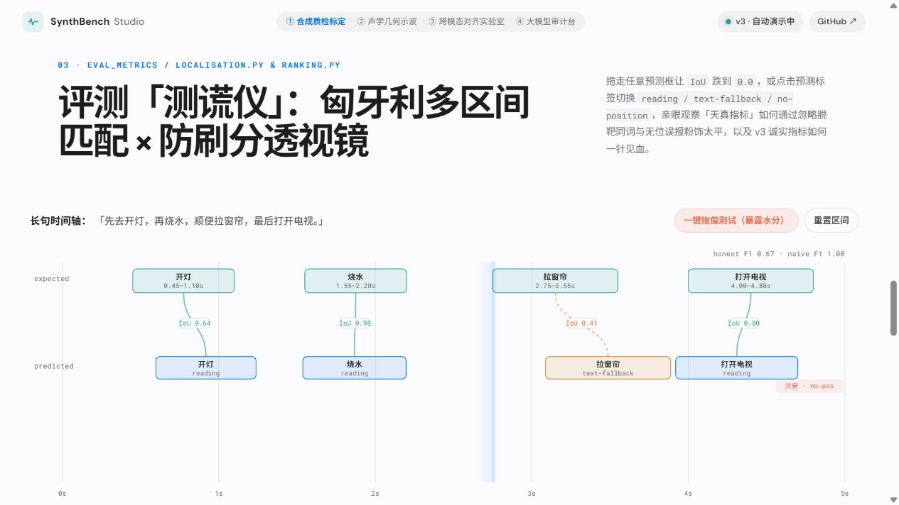
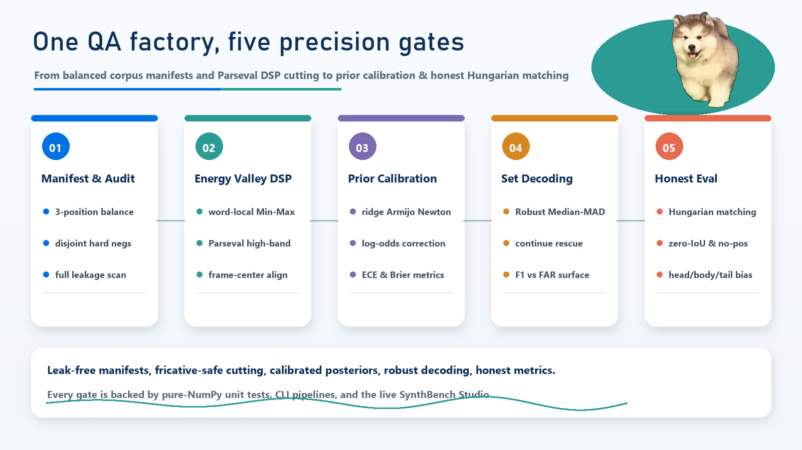

<p align="center">
  <a href="https://github.com/leeoisaboy/wu-speech-synthbench">
    
  </a>
</p>

<p align="center">
  <a href="README.md"></a>
  <a href="https://leeoisaboy.github.io/wu-speech-synthbench/"></a>
  
  
  
  
</p>

<h1 align="center">Wu-Speech-SynthBench</h1>

<p align="center"><strong>A white-box workflow for planning synthetic dialect corpora, timestamping speech, calibrating predictions, and evaluating retrieval honestly.</strong></p>


## Running interface

<p align="center">
  <a href="https://leeoisaboy.github.io/wu-speech-synthbench/">
    
  </a>
</p>

<p align="center"><strong><a href="https://leeoisaboy.github.io/wu-speech-synthbench/">Open SynthBench Studio</a></strong></p>

The recording above comes from the live static page. Each unit is a borderless, full-viewport chapter. It fades in on entry, recedes naturally on exit, and the charts draw themselves and continue to evolve. Pointer input takes over the autonomous demo, then hands control back after a short pause. There is no backend and no audio upload. A dropped WAV or a microphone sample is decoded inside the browser. The four modules expose the repository's automatic timestamping, set decoding, probability calibration, multi-span localisation, and corpus-planning logic.

| Module | What the page shows | Implementation |
| --- | --- | --- |
| 01 Energy-valley timestamping | Waveform anchors, dual-band energy, spectral-flux cost valley, posterior crossover, automatic cut lines | `auto_timestamp/energy_valley.py` |
| 02 Set decoding and calibration | Robust Median-MAD, Z-score, `continue` rescue, reliability diagram, operating surface | `set_prediction/multi_kw_decoder.py`, `score_vector_baseline.py` |
| 03 Evaluation lie detector | Multi-span Hungarian matching, IoU penalties, honest metrics, frequency-bias scatter plot | `eval_metrics/localisation.py`, `ranking.py` |
| 04 Corpus-planning sandbox | Head, middle, tail coverage heatmap, substring conflicts, negative-sample leakage audit | `synth_pipeline/manifest.py` |

<details>
<summary>Expand the four module screenshots</summary>
<p align="center">
  
  
  
  
</p>
</details>

## Why this project exists

Low-resource dialect speech often lacks sufficient recordings, time boundaries, and negative samples. Teams synthesize a corpus, derive supervision spans, apply a set decoder, and then measure localisation, recall, and false alarms. Each stage can look reasonable on its own while an earlier bias is amplified downstream.

Digital silence can flatten an in-word energy valley. A voiceless fricative may already sit below the normal speech-band floor. Class imbalance can inflate posterior probabilities. Multi-span evaluation can award credit to off-target predictions when zero-overlap pairs are ignored. A hard negative that contains an enrolled phrase corrupts the metric once more. This repository turns those failure modes into executable checks and visible controls.

The core package depends only on NumPy. Studio consumes a deterministic exported JSON bundle and recomputes interactive states in the browser. The Python implementation remains the reference for formal results.

## Questions

1. Can word-local normalisation keep edge silence from flattening real in-word valleys?
2. Can Parseval-consistent high-band energy preserve fricatives and aspirates?
3. Can frame-centre resampling remove the half-window timing bias?
4. Can set decoding survive outlier score spikes and probability-rank divergence?
5. Can prior correction recover calibrated posteriors after class weighting?
6. Can multi-span localisation penalise both off-target same-word matches and no-position false positives?
7. Can three-position planning and full-lexicon leakage checks stop contract violations before generation?

## Five engineering fixes

### 1. Word-local Min-Max

`segment_word` normalises energy and spectral flux only inside `[left : right + 1]`. Digital silence at the utterance edges no longer dominates the dynamic range, so the cost valley used for an internal character cut remains visible.

### 2. Parseval-consistent high-band energy

`acoustic_features` computes the `2000–4000 Hz` sub-band with exact one-sided real-FFT Parseval weights. Narrow-band fricatives are measured on the same physical dB scale as time-domain energy. `fused_db = max(energy_db, high_band_db - 6)` keeps consonant evidence that the ordinary speech band has already attenuated.

### 3. Frame-centre posterior alignment

External posteriors are resampled at `frame * hop + half_window`. A 25 ms analysis window has a 12.5 ms half-window offset. Ignoring it shifts posterior crossovers away from acoustic boundaries.

### 4. Calibrated rejection

With `class_weight="balanced"` and `correct_prior=True`, `LogisticCalibrator` applies:

```text
logit(p_cal) = logit(p_bal) - ln(w1 / w0)
```

`decode_set` uses `continue` when a probability-ranked candidate fails the z-space margin. One divergent candidate no longer terminates the loop and removes a later true target.

### 5. Honest multi-span evaluation

`evaluate_multi_span_localisation` retains same-word pairs with `IoU = 0.0`, counts `no-position` predictions in end-to-end precision, and uses per-word maximum-weight bipartite matching. `sentence_recall_complete` uses positive utterances only, so negative samples no longer contribute an artificial floor.

## Evidence

The numbers below come from deterministic synthetic fixtures and the exported Studio bundle. They validate interfaces, numerical contracts, and failure modes. They do not represent production accuracy on real Wu or Mandarin speech.

| Probe | Result | Interpretation |
| --- | --- | --- |
| Split of the built-in `烧水` sample | `0.2025–0.4725 s` and `0.4725–0.7625 s` | 98 acoustic frames; Studio and the Python reference agree |
| Uncorrected calibration | ECE `0.1878`, Brier `0.1286` | Posteriors are visibly inflated after class weighting |
| Prior-corrected calibration | ECE `0.0282`, Brier `0.0805` | The reliability curve returns near the diagonal |
| Negative-sample floor | naive `0.68`, v3 `0.36` | v3 computes complete recall over positives only |
| Multi-span localisation | known-word IoU `0.7818`, precision `0.80`, recall `1.00` | One of five predictions is `no-position` and still counts in end-to-end precision |
| Head-biased frequency model | Micro `84.66%`, Macro `62.30%`, Tail `31.50%` | Micro recall looks healthy while long-tail phrases collapse |
| Balanced frequency model | Micro `85.74%`, Macro `83.40%`, Tail `80.50%` | Long-tail recall returns near the overall level |
| Default plan audit | 27 records; zero substring, hard-negative, and background leaks | Public synthetic fixture from `demo_plan` and `validate_plan` |



## Method

### Automatic timestamping

The acoustic front end uses a 10 ms hop, a 25 ms Hann window, a zero-phase `300–3400 Hz` speech band-pass, windowed RMS energy, high-band energy, and half-wave rectified spectral flux. `_refine_edge` expands each coarse anchor until sustained activity ends. Internal cuts use the minimum of the in-word energy-plus-flux cost, optionally blended with posterior crossover.

### Set decoding

Within-utterance scores are normalised before thresholding. Robust Median-MAD uses `1.4826 * MAD`, which remains stable in the presence of an outlier spike. The calibrator maps `[raw, norm, gap_to_top, rank_ratio]` to probability. `cap`, `margin`, `minimum_z`, and `min_probability` constrain the selected set.

### Multi-span localisation

Phrase-agnostic end-to-end matching measures the best overlap for every expected span. Same-phrase matching runs separately and retains zero-overlap pairs. The evaluator reports `precision_at_iou`, `positionable_precision_at_iou`, `recall_at_iou`, and `f1_at_iou`.

### Planning and leakage audit

The planner places targets at the head, middle, tail, and inside multi-target carriers. `validate_plan` checks carrier spans, subset isolation, hard-negative leakage, background leakage, and substring collisions. Default confusion phrases are drawn from an unregistered pool.

## Quick start

```bash
git clone https://github.com/leeoisaboy/wu-speech-synthbench.git
cd wu-speech-synthbench
python -m venv .venv
```

Windows PowerShell:

```powershell
.venv\Scripts\Activate.ps1
python -m pip install -e . pytest
```

Linux or macOS:

```bash
source .venv/bin/activate
python -m pip install -e . pytest
```

Run the test suite:

```bash
python -m pytest -q
```

Current result: `17 passed`.

Generate a deterministic demo report:

```bash
wu-speech-synthbench demo --multi-phrase-ratio 0.3 --output report.json
```

Run a calibrated rejection sweep:

```bash
wu-speech-synthbench evaluate \
  --sets eval_sets.jsonl \
  --calibrator-train cal_sets.jsonl \
  --caps 1,2,3 \
  --margins 0.5,1.5 \
  --min-probabilities none,0.3,0.5,0.7 \
  --normalization robust
```

## Use Studio

Open the public page:

<https://leeoisaboy.github.io/wu-speech-synthbench/>

Run the static site locally:

```bash
python scripts/export_synthbench_bundle.py
python -m http.server 8765 --directory studio
```

Then visit `http://127.0.0.1:8765`.

The page supports WAV drop and microphone recording, local versus global normalisation, acoustic versus frame-centre posterior alignment, decoder thresholds, prior correction, span dragging, source switching, and live corpus-plan audits.

## Repository layout

```text
wu_speech_synthbench/
  auto_timestamp/energy_valley.py
  set_prediction/multi_kw_decoder.py
  set_prediction/score_vector_baseline.py
  eval_metrics/localisation.py
  eval_metrics/ranking.py
  synth_pipeline/manifest.py
studio/
  index.html
  static/studio.css
  static/studio.js
  data/synthbench_bundle.json
docs/
  DATA_CONTRACT.md
  MODULE_MAP.md
  assets/
scripts/
  export_synthbench_bundle.py
  make_assets.py
tests/
  17 numerical, audio, calibration, matching, planning, and Studio contract tests
```

## Reproduction

```bash
python -m compileall -q .
python -m pytest -q
node --check studio/static/studio.js
python scripts/export_synthbench_bundle.py
```

See [docs/DATA_CONTRACT.md](docs/DATA_CONTRACT.md) for the data contract and [docs/MODULE_MAP.md](docs/MODULE_MAP.md) for module responsibilities.

## White-box dialect speech quartet

1. **Wu-Speech-SynthBench**: synthetic corpus planning, signal timestamping, calibration, and honest evaluation.
2. [Disentangle-Acoustic-Print](https://leeoisaboy.github.io/disentangle-acoustic-print/): static, motion, residual, and speed views of frozen acoustic trajectories.
3. [Dialect-CrossModal-Align](https://leeoisaboy.github.io/dialect-crossmodal-align/): cross-modal alignment, domain regularisation, and routing-trap ablations.
4. [AudioLLM-Latent-KWS](https://leeoisaboy.github.io/audiollm-latent-kws/): retrieval, leakage, and negative-result audits for frozen Audio-LLMs.

## Scope and limitations

- The repository contains code, schemas, deterministic synthetic fixtures, and static demo data.
- It contains no real audio, private lexicons, speaker identities, model weights, or restricted corpora.
- Built-in Studio samples explain the algorithms and do not establish real-world recognition accuracy.
- Browser DSP is an interactive teaching reproduction; the Python NumPy implementation is the numerical reference.
- A production benchmark also requires licensed recordings, transcripts, and documented splits.

## License

The code is released under the MIT License. Audio, models, lexicons, and derived features retain their original licenses.
