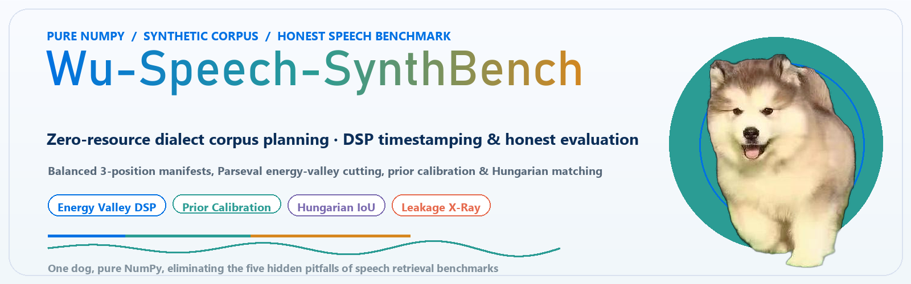
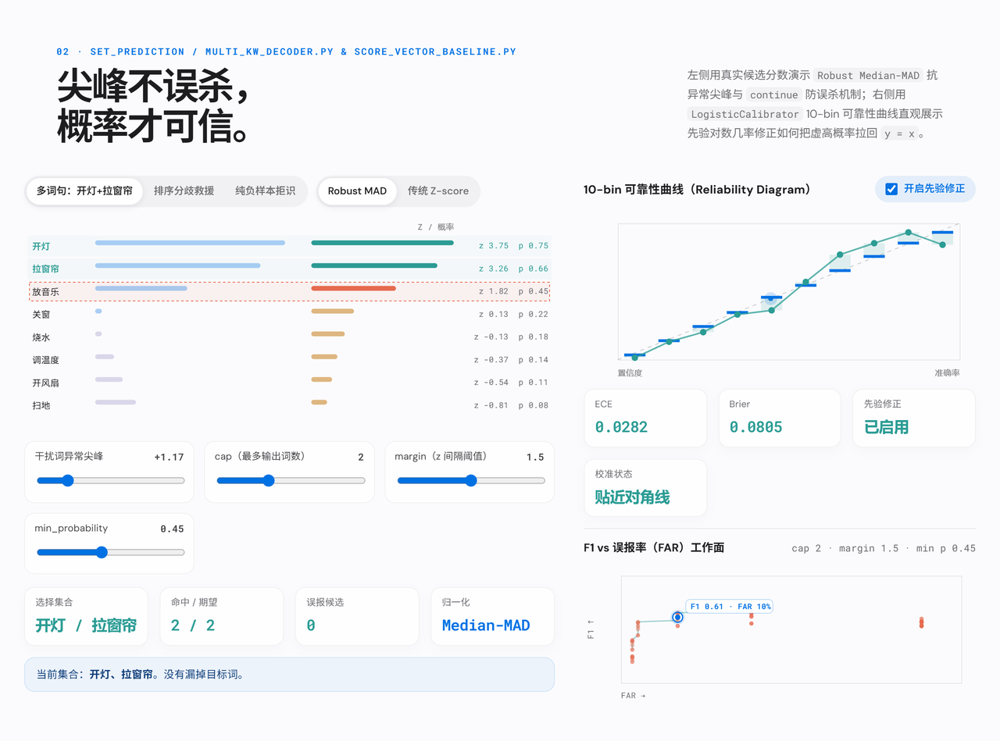

<p align="center">
  <a href="https://github.com/leeoisaboy/wu-speech-synthbench">
    
  </a>
</p>

<p align="center">
  <a href="README.md"></a>
  <a href="https://leeoisaboy.github.io/wu-speech-synthbench/"></a>
  <a href="https://leeoisaboy.github.io/disentangle-acoustic-print/"></a>
  <a href="https://leeoisaboy.github.io/dialect-crossmodal-align/"></a>
  <a href="https://leeoisaboy.github.io/audiollm-latent-kws/"></a>
  
  
  
</p>

<h1 align="center">Wu-Speech-SynthBench</h1>

<p align="center"><strong>Zero-resource synthetic dialect corpus planning, signal-level timestamping, probability calibration, and honest evaluation — pure NumPy with a live zero-backend Studio.</strong></p>

## Live Interactive Bench: SynthBench Studio

<p align="center">
  <a href="https://leeoisaboy.github.io/wu-speech-synthbench/">
    
  </a>
</p>

<p align="center"><strong><a href="https://leeoisaboy.github.io/wu-speech-synthbench/">▶ Open Live SynthBench Studio</a></strong></p>

Everything in the preview runs directly in your browser with zero backend. Drop in a local `.wav` file or record a 2-second clip with your microphone to inspect live energy-valley cuts, drag sliders to see calibration curves snap back to `y = x`, or drag predicted spans out of overlap to see how inflated metrics diverge from honest ones.

| Module | What you can explore live | Core Implementation |
| --- | --- | --- |
| **01 Energy-Valley Microscope** | Drag character anchors, toggle word-local normalization & frame-center alignment, drop `.wav` or record live audio | `auto_timestamp/energy_valley.py` |
| **02 Set Decoder & Calibration** | Inject distractor spikes to compare Robust MAD vs Z-score, sweep `cap / margin / min_probability`, toggle log-odds prior correction | `set_prediction/multi_kw_decoder.py`, `score_vector_baseline.py` |
| **03 Multi-Span Lie Detector** | Drag predicted spans on a long utterance or toggle `no-position`, compare lenient vs honest scores, inspect head/body/tail recall bias | `eval_metrics/localisation.py`, `ranking.py` |
| **04 Corpus Plan & Leakage X-Ray** | Edit a custom lexicon to inspect 3-position balance and trigger `validate_plan` leakage & substring conflict scans | `synth_pipeline/manifest.py` |

<details>
<summary>Expand full-resolution screenshots of all four modules</summary>
<p align="center">
  
  
  
  
</p>
</details>

---

## Why This Toolkit Exists

Building keyword spotting or phrase retrieval benchmarks for low-resource dialects usually starts from synthetic TTS audio, followed by automatic character timestamping, multi-word set decoding, and localisation/ranking evaluation. Along that pipeline, five subtle pitfalls routinely distort experimental conclusions:

1. **Leading/trailing silence flattens energy valleys**: Digital `-120 dB` silence at utterance edges compresses in-word syllable dips when normalized globally, making boundary cuts drift.
2. **Voiceless fricatives and aspirates get clipped**: Consonants like `sh` or `k` carry their energy in the `2000–4000 Hz` band even when standard `300–3400 Hz` speech energy drops near zero.
3. **Class-weighted classifiers output inflated probabilities**: Using `class_weight="balanced"` improves recall on rare positives, but shifts posterior probabilities systematically above true empirical accuracy.
4. **Lenient evaluation hides localisation failures**: Dropping zero-overlap same-phrase pairs, excluding `no-position` false alarms from the precision denominator, or counting negative utterances inside `sentence_recall_complete` produces artificially high numbers.
5. **Synthetic manifests silently leak or deadlock**: Naive modulo assignment locks words to a single sentence slot whenever `len(lexicon) % 3 == 0`, and unguarded hard negatives or background prompts can accidentally contain enrolled hotwords.

**Wu-Speech-SynthBench** packages the entire pipeline into a clean, **pure-NumPy** library with deterministic unit tests, CLI workflows, and an interactive browser Studio.

---

## Architecture & Core Modules

<p align="center">
  
</p>

1. **Balanced Corpus Planning & Leakage Audit (`synth_pipeline/manifest.py`)**: Distributes every enrolled phrase evenly across `head`, `middle`, and `tail` slots plus multi-phrase utterances, draws fallback confusions from a disjoint unregistered pool, and audits every `hard_negative` and `background` record against the full enrolled lexicon alongside substring conflict detection.
2. **Signal-Level Energy-Valley Timestamping (`auto_timestamp/energy_valley.py`)**: Runs zero-phase FFT bandpass (`300–3400 Hz`), Hann windowing, Parseval-consistent high-band energy (`2000–4000 Hz`), word-local Min-Max normalization inside `[left : right + 1]`, and frame-center posterior resampling (`frame * hop + half_window`).
3. **Calibrated Multi-Word Set Decoding (`set_prediction/`)**: Combines outlier-resistant `Robust Median-MAD` (`1.4826 * MAD`) normalization, ridge-regularized `LogisticCalibrator` with exact log-odds prior correction (`logit(p_cal) = logit(p_bal) - ln(w1 / w0)`), and probability-ordered set decoding that skips z-margin rejections with `continue` rather than prematurely terminating the loop.
4. **Honest Multi-Span Localisation & Ranking (`eval_metrics/`)**: Uses a pure-NumPy Hungarian algorithm (`_max_weight_bipartite_matching`) that retains same-phrase zero-overlap pairs (`IoU = 0.0`), charges `no-position` predictions to the end-to-end `precision_at_iou` denominator, computes `sentence_recall_complete` strictly over positive utterances, provides tie-invariant `pr_auc`, and measures `head / body / tail` frequency bias via Pearson and Spearman correlations.

---

## Quick Start

```bash
git clone https://github.com/leeoisaboy/wu-speech-synthbench.git
cd wu-speech-synthbench
python -m venv .venv
source .venv/bin/activate        # Windows PowerShell: .venv\Scripts\Activate.ps1
python -m pip install -e . pytest
python -m pytest -q
```

Run the deterministic end-to-end CLI demo:

```bash
wu-speech-synthbench demo --multi-phrase-ratio 0.3 --output report.json
```

Run SynthBench Studio locally (no backend needed):

```bash
python scripts/export_synthbench_bundle.py
python -m http.server 8765 --directory studio
```

Then open `http://127.0.0.1:8765`, or visit the live GitHub Pages site at <https://leeoisaboy.github.io/wu-speech-synthbench/>.

---

## Low-Resource Dialect White-Box Quartet

| # | Repository | Role | Live Studio |
| --- | --- | --- | --- |
| **1** | **[wu-speech-synthbench](https://github.com/leeoisaboy/wu-speech-synthbench)** (this repo) | **QA & Calibration Factory**: synthetic manifests, DSP timestamping, calibration & honest metrics | [SynthBench Studio](https://leeoisaboy.github.io/wu-speech-synthbench/) |
| **2** | **[disentangle-acoustic-print](https://github.com/leeoisaboy/disentangle-acoustic-print)** | **Acoustic Oscilloscope**: training-free speaker disentanglement & arc-length speed alignment | [Acoustic Print Studio](https://leeoisaboy.github.io/disentangle-acoustic-print/) |
| **3** | **[dialect-crossmodal-align](https://github.com/leeoisaboy/dialect-crossmodal-align)** | **Cross-Modal Lab**: compositional zero-shot OOV, speed-invariant attention & routing-trap ablations | [CrossModal Align Lab](https://leeoisaboy.github.io/dialect-crossmodal-align/) |
| **4** | **[audiollm-latent-kws](https://github.com/leeoisaboy/audiollm-latent-kws)** | **Audio-LLM Audit Bench**: 80ms/40ms leak-free retrieval, Top-20 reranking & prefix KV-cache | [Latent-KWS Audit Studio](https://leeoisaboy.github.io/audiollm-latent-kws/) |

## License

Released under the [MIT License](LICENSE).
