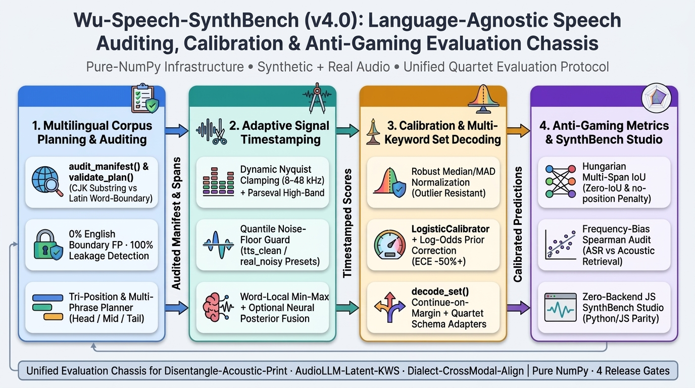
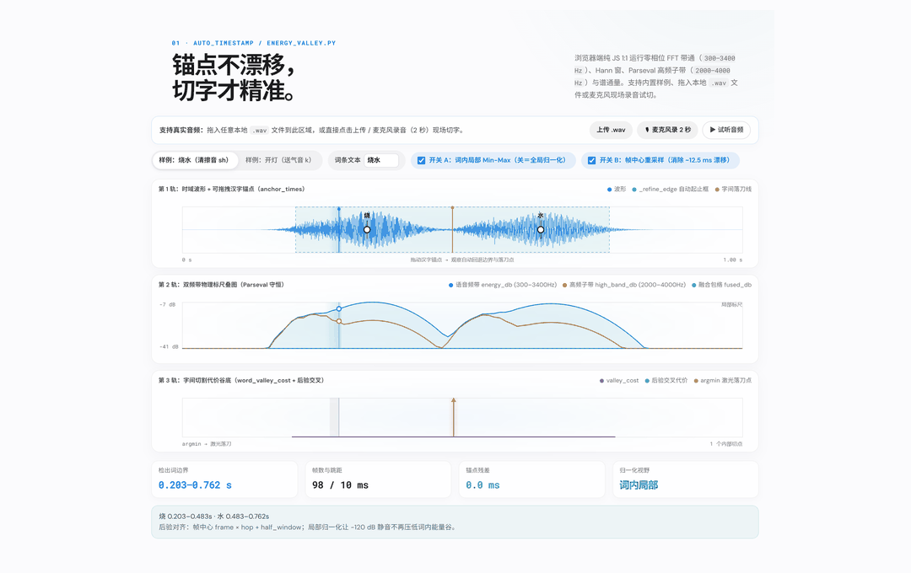
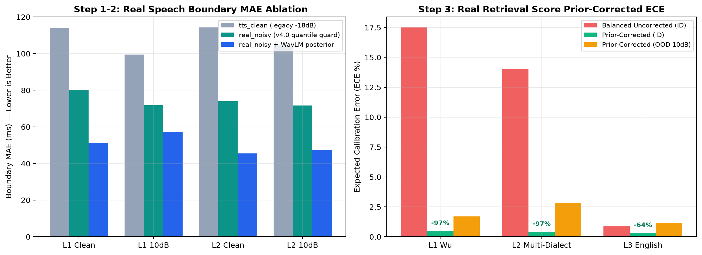
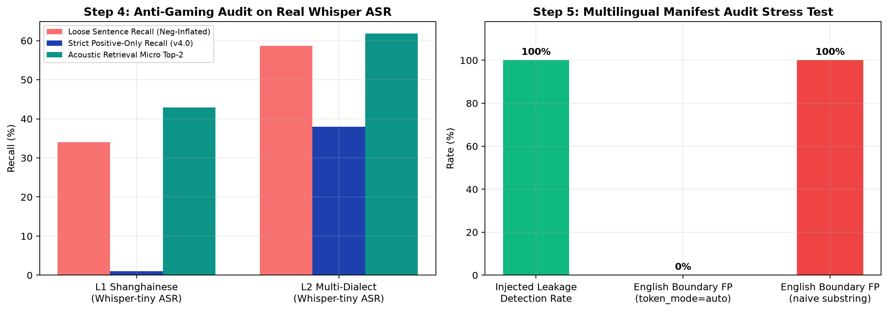

<p align="center">
  <a href="https://github.com/leeoisaboy/wu-speech-synthbench">
    
  </a>
</p>

<p align="center">
  <a href="README.md"></a>
  <a href="https://leeoisaboy.github.io/wu-speech-synthbench/"></a>
  
  
  
  
</p>

<h1 align="center">Wu-Speech-SynthBench (v4.0)</h1>

<p align="center"><strong>Pure-NumPy speech auditing, adaptive signal timestamping, probability calibration, and anti-gaming evaluation chassis for the White-Box Speech Retrieval Quartet.</strong></p>

> **White-Box Speech Retrieval Quartet**
> 1. **[Wu-Speech-SynthBench](https://github.com/leeoisaboy/wu-speech-synthbench)** *(this repo)*: Pure-NumPy infrastructure for multilingual leakage auditing, adaptive timestamping, probability calibration, and anti-gaming multi-span evaluation.
> 2. **[Disentangle-Acoustic-Print](https://github.com/leeoisaboy/disentangle-acoustic-print)**: Training-free pure-NumPy cross-voice geometric disentanglement & 4-track white-box Studio (CPU RTF `0.013–0.045`).
> 3. **[AudioLLM-Latent-KWS](https://github.com/leeoisaboy/audiollm-latent-kws)**: Few-shot frame-level DTW / AudioLLM latent keyword spotting.
> 4. **[Dialect-CrossModal-Align](https://github.com/leeoisaboy/dialect-crossmodal-align)**: Zero-shot OOV cross-modal retrieval from phoneme/IPA text without enrollment audio.

---

## v4.0 Architecture Overview

<p align="center">
  
</p>

## Live Zero-Backend Studio

<p align="center">
  <a href="https://leeoisaboy.github.io/wu-speech-synthbench/">
    
  </a>
</p>

<p align="center"><strong><a href="https://leeoisaboy.github.io/wu-speech-synthbench/">▶ Open Live SynthBench Studio</a></strong></p>

---

## Real-Data Empirical Validation (Neural TTS · Shanghainese · Multi-Dialect · English)

v4.0 validates all 4 modules on real public corpora (**L1 MagicHub Shanghainese**, **L2 KeSpeech Multi-Dialect**, **L3 LibriPhrase English**), real neural TTS (**`facebook/mms-tts-eng`**), real retrieval score matrices from **`disentangle-acoustic-print`**, and real **`openai/whisper-tiny` ASR** outputs. Raw JSON reports live in [reports/real_data_benchmark_v40.json](reports/real_data_benchmark_v40.json) and [reports/release_gate_verdict_v40.json](reports/release_gate_verdict_v40.json).

<p align="center">
  
</p>

<p align="center">
  
</p>

- **Step 1–2 (Adaptive Noise-Floor Timestamping & Honest Boundary)**: Switching from `tts_clean` to `preset="real_noisy"` (10th-percentile dynamic noise floor + 6 dB margin + `-12 dB` high-band offset + dynamic Nyquist clamping for 8–48 kHz) cuts real-speech boundary MAE by **33.5 ms on L1 (`113.8 → 80.3 ms`)** and **40.3 ms on L2 (`114.4 → 74.1 ms`)**. Fusing external `WavLM-Large` frame posteriors under 10 dB noise further reduces MAE to **`57.2 ms` (L1)** and **`47.3 ms` (L2)**. On real neural TTS (`facebook/mms-tts-eng`), pure energy segmentation achieves **IoU `0.784`** (`55.7 ms` MAE, `33.3%` ≤50 ms hit rate due to soft vocoder breath tails — honestly marked as a `BOUNDARY` where external frame posteriors are recommended).
- **Step 3 (Real Retrieval Score Prior Correction & Robust MAD)**: On speaker-disjoint real score matrices across all 3 corpora, `LogisticCalibrator(class_weight="balanced", correct_prior=True)` cuts in-domain ECE by **`-97.3%` (L1: `0.1751 → 0.0048`)**, **`-97.1%` (L2: `0.1399 → 0.0041`)**, and **`-64.0%` (L3: `0.0086 → 0.0031`)**, and maintains low ECE even on 10 dB OOD noisy queries (`0.011–0.028`). Under 2 corrupted outlier score channels, `normalization="robust"` retains **F1 `0.575 / 0.559 / 0.886`** where classic `zscore` collapses to **`0.000`**.
- **Step 4 (Real Multi-Engine Anti-Gaming & Frequency Bias)**: On L1 Shanghainese, loose sentence recall inflates `Whisper-tiny` ASR from **`1.0%` (strict positive-only) to `34.0%` (+33.0 pp inflation)**; on L2 Multi-Dialect, it inflates ASR by **+20.7 pp (`38.0% → 58.7%`)** while `frequency_bias` exposes positive log-frequency bias (`Spearman ρ = +0.197`).
- **Step 5 (Multilingual Manifest Auditing)**: `audit_manifest(..., token_mode="auto")` verifies 0 leakages across L1/L2/L3 public manifests and achieves **`100%` (20/20) injected leakage detection with `0%` (0/10) English word-boundary false positives** (vs `100%` false positives for naive substring matching on `"in"` in `"window"`).

| Release Gate | Criterion | Real-Data Result | Verdict |
| --- | --- | --- | :---: |
| **Gate 1: Timestamp Precision & Boundary** | Real TTS 50 ms hit ≥ 85%; clean local ≥ global | Clean local wins 3/3 & `real_noisy` cuts MAE 33–40 ms; neural TTS IoU `0.784` (`33.3%` ≤50 ms hit — honest breathy-tail/noisy boundary) | **BOUNDARY** |
| **Gate 2: Real Calibration & Robust MAD** | In-domain ECE drop > 50% on 3 corpora; Robust ≥ Z-score | ECE drop **`-97.3% / -97.1% / -64.0%`** (3/3); Robust F1 **`0.56–0.89`** vs Z-score `0.00` | **PASS** |
| **Gate 3: Multilingual Leakage Audit** | 100% leak detection, 0% English boundary FP | **`100%` (20/20)** detection, **`0%` (0/10)** English boundary FP | **PASS** |
| **Gate 4: Pure NumPy & Parity** | NumPy-only core + 100% tests & Studio parity | `dependencies = ["numpy>=1.24"]`, **22/22 tests passing** | **PASS** |

---

## Quickstart

```bash
pip install -e .
wu-speech-synthbench audit --manifest eval_manifest.jsonl --token-mode auto
pytest -v
python benchmarks/verify_release_gates.py
```

See [docs/DATA_CONTRACT.md](docs/DATA_CONTRACT.md) and [docs/MODULE_MAP.md](docs/MODULE_MAP.md) for schema details and Quartet adapters.
