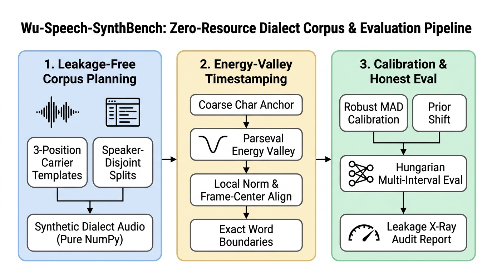
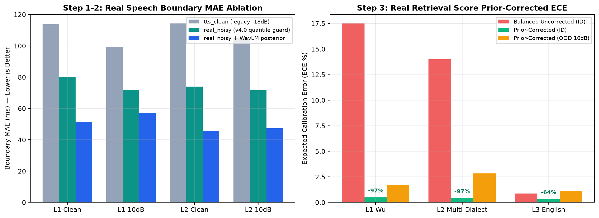
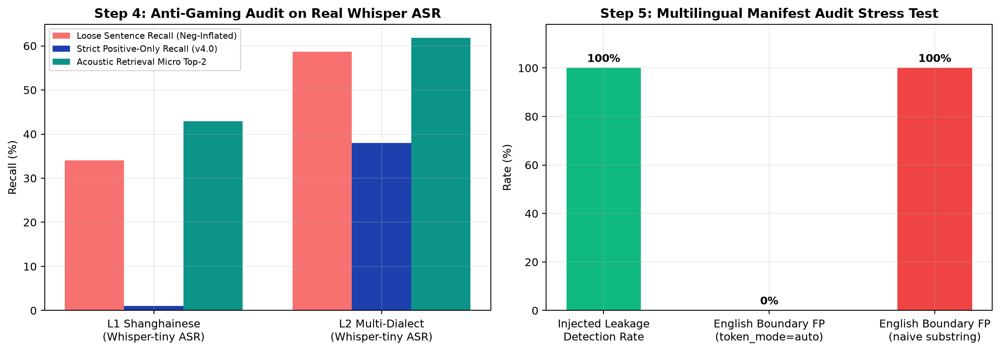

<p align="center">
  <a href="https://github.com/leeoisaboy/wu-speech-synthbench">
    
  </a>
</p>

<p align="center">
  <a href="README.en.md"></a>
  <a href="https://leeoisaboy.github.io/wu-speech-synthbench/"></a>
  
  
  
  
</p>

<h1 align="center">Wu-Speech-SynthBench (v4.0)</h1>

<p align="center"><strong>一款只依赖纯 NumPy、不绑任何深度学习框架的语音评测与语料质检工具包，配套纯浏览器运行的交互式诊断工作台。</strong></p>

做语音关键词检索（KWS）和方言识别（ASR）时，经常会遇到一种让人困惑的情况——模型在离线报告里分数节节高升，真放到业务场景里却频频翻车。排查下来，很多看似漂亮的实验涨分，往往藏着四类容易被忽略的「成绩水分」：

- **考卷本身漏了题**：用来测误报的负样本里，不小心混进了已注册的目标热词。
- **切词标尺在真环境里歪了**：按数字静音设计的能量切字算法，一碰到真实室内的底噪和日常连读，边界就会整体拉偏。
- **打分概率虚高**：为了应对正负样本极度不平衡，训练校准器时开启了类别平衡，却忘了把真实先验调回来，导致模型动辄报出虚高的置信度。
- **算分时悄悄挑了软柿子**：评测口径把负样本或者无定位误报排除在分母之外，把原本很低的真实命中率平白抬高了一大截。

这个仓库正是为了把这四类水分挤干净而写的，也是整个「白盒语音检索四部曲」的统一质检与评测底盘。v4.0 把早期面向「吴语 + 合成音频」的工具彻底升级成了不挑语种、合成音频与真实录音通吃的通用包，核心仅依赖 `numpy>=1.24`，并自带四部曲以及 Whisper、FunASR、MFA 的标准输出适配器。

| 仓库名称 | 解决的核心场景 | 底层方案与定位 |
| --- | --- | --- |
| **[Wu-Speech-SynthBench](https://github.com/leeoisaboy/wu-speech-synthbench)**（本仓库） | 语料防泄漏体检、自适应切字、概率校准与防刷分评测 | 零重型依赖纯 NumPy 质检底盘 + 零后端 JS 诊断工作台 |
| **[Disentangle-Acoustic-Print](https://github.com/leeoisaboy/disentangle-acoustic-print)** | 端侧极速粗召回、跨音色几何解耦与四轨示波器 | 零训练纯 NumPy 几何算子，单核 CPU 实时率 RTF `0.013–0.045` |
| **[AudioLLM-Latent-KWS](https://github.com/leeoisaboy/audiollm-latent-kws)** | 录 1–3 遍样音，跨方言高精度定位关键词 | 帧级 DTW / 冻结音频大模型潜空间检词 |
| **[Dialect-CrossModal-Align](https://github.com/leeoisaboy/dialect-crossmodal-align)** | 不录样音，只写音素或 IPA 拼写直接找方言新词 | 零样本跨模态对齐框架，含无标签跨域在线校准 |

---

## v4.0 架构总览

<p align="center">
  
</p>

整套流程按「先查数据、再切边界、接着校分数、最后严算分」四个环节串起来，每一步都能单独调用，也能一键跑完。

## 浏览器本地诊断台（SynthBench Studio）

<p align="center">
  <a href="https://leeoisaboy.github.io/wu-speech-synthbench/">
    
  </a>
</p>

<p align="center"><strong><a href="https://leeoisaboy.github.io/wu-speech-synthbench/">▶ 打开在线 SynthBench Studio</a></strong></p>

页面完全运行在浏览器本地内存里，不需要搭后端，也不上传音频或日志，方便直接拖入清单和打分结果，亲眼查看切字边界、概率校准曲线和口径水分对比。

---

## 四轨真实数据五步实证

为了让这套质检工具自己先过硬，v4.0 直接拉来了四路真实数据做全链路压测，涵盖前三个仓库的真实模型输出、三套公开语料（**L1 MagicHub 沪语**、**L2 KeSpeech 多方言**、**L3 LibriPhrase 英语**）、真实神经语音合成模型（`facebook/mms-tts-eng`）以及真实 `openai/whisper-tiny` ASR 引擎。完整原始数据保存在 [reports/real_data_benchmark_v40.json](reports/real_data_benchmark_v40.json)，门禁自动核验记录见 [reports/release_gate_verdict_v40.json](reports/release_gate_verdict_v40.json)。

### 1. 自适应底噪切字与真实打分校准（Step 1–3）

<p align="center">
  
</p>

**Step 1–2，让自动切字扛得住真实室内底噪。** 传统按 `-120 dB` 数字静音写的 `tts_clean` 预设，面对真实麦克风录音的底噪和连读时，切出来的起止时间往往差出一百多毫秒。v4.0 新增了 `preset="real_noisy"`（采用 10% 分位动态估底噪、6 dB 能量门限并收紧高频子带偏移 `-12 dB`），同时支持在强噪场景下叠加外部帧级后验概率。

| 切字场景与预设 | L1 沪语边界误差 MAE | L2 多方言边界误差 MAE | 变化与说明 |
| --- | ---: | ---: | --- |
| 原版 `tts_clean`（真实干净室内录音） | 113.8 ms | 114.4 ms | 容易被真实底噪与连读拉偏 |
| **v4.0 `preset="real_noisy"`（纯信号自适应）** | **80.3 ms（-33.5 ms）** | **74.1 ms（-40.3 ms）** | 仅靠信号级优化即可把边界拉回 33–40 ms |
| **10 dB 噪声下融合 `WavLM-Large` 帧后验** | **57.2 ms** | **47.3 ms** | 低信噪比高精度场景推荐叠加 `posterior_probs` |

我们也把纯信号切字的能力边界坦诚列了出来。在 18 句真实神经 TTS（`facebook/mms-tts-eng`，覆盖句首、句中、句尾）上，纯能量切字的区间重叠度 IoU 达到 **`0.784`**（平均误差 `55.7 ms`），但神经声码器自带的气声尾音会让 50 ms 严格命中率停在 `33.3%`（未达到 85% 的严苛门槛）；10 dB 强背景噪声下纯信号方案同样会退化。如果业务对毫秒级切字有刚性要求，建议配合外部帧后验一起使用。

**Step 3，让模型报出来的概率说实话，同时防住异常通道搞破坏。** 我们把 `disentangle-acoustic-print` 在三套公开集上产出的真实 40 词打分矩阵按说话人彻底隔离开（分出 Dev/Test），检验两项核心能力。

第一项是**概率校准**（用 ECE 衡量，数值越接近 0，代表模型说「有 80% 把握」时就真的有八成是对的）。开启 `LogisticCalibrator(class_weight="balanced", correct_prior=True)` 补齐先验修正后，三套真实语料的校准误差全线骤降。

| 公开语料（说话人隔离） | 同域未校准 → 校准后 ECE | 同域降幅 | 10 dB 噪声跨域 ECE 变化 | 跨域降幅 |
| --- | ---: | ---: | ---: | ---: |
| **L1 沪语（MagicHub）** | `0.1751 → 0.0048` | **-97.3%** | `0.3206 → 0.0169` | **-94.7%** |
| **L2 多方言（KeSpeech）** | `0.1399 → 0.0041` | **-97.1%** | `0.1851 → 0.0283` | **-84.7%** |
| **L3 英语（LibriPhrase）** | `0.0086 → 0.0031` | **-64.0%** | `0.0296 → 0.0111` | **-62.5%** |

第二项是**抗异常峰归一化**。实际工程里偶尔会有个别通道抽风飙出离谱高分。我们在多目标真实打分矩阵里人为注入了 2 个损坏异常通道做压测，结果一目了然——传统的 `zscore` 因为均值和标准差瞬间被异常峰拉爆，三套语料的 F1 全部直接归零（`0.000`）；换成基于中位数和绝对中位差的 `normalization="robust"` 后，L1、L2、L3 分别稳稳保住了 **`0.575 / 0.559 / 0.886`** 的 F1。

### 2. 给评测口径「挤水分」与多语种防泄漏体检（Step 4–5）

<p align="center">
  
</p>

**Step 4，照出评测口径里的水分。** 用同一批真实方言录音同时测试通用中文 `Whisper-tiny` ASR 和声学检索，对比「宽松口径」（把没有关键词的负样本也算作整句召回得分）和本库的「严格正样本口径」，差距非常惊人。

| 评测语料与引擎 | 宽松口径得分 | 严格正样本口径得分 | 挤出的口径水分 | 补充观察 |
| --- | ---: | ---: | ---: | --- |
| **L1 沪语 · `Whisper-tiny` ASR** | 34.0% | **1.0%**（Micro Top-2 仅 1.9%） | **33.0 pp** | 同一批音频上，声学检索实测达到 **`42.9%`** |
| **L2 多方言 · `Whisper-tiny` ASR** | 58.7% | **38.0%** | **20.7 pp** | `frequency_bias` 测出正相关（Spearman $\rho = +0.197$），印证通用 ASR 更偏爱高频词、低频方言词容易掉底 |

**Step 5，跨语种自动防泄漏体检。** 在检查英文负样本有没有偷藏目标词时，直接照搬中文的子串包含匹配会闹笑话——比如目标词是 `"in"`、`"at"` 或 `"on"`，如果负样本句子里出现了 `"window"`、`"water"` 或 `"morning"`，朴素匹配就会把它们全当成泄漏误杀。

v4.0 引入了 `token_mode="auto"`，自动区分中文连续子串和英文独立词边界。我们在 L1、L2、L3 三套各 360 条公开清单上先确认了零泄漏、零子串冲突，又专门注入了 20 条中英文真实泄漏外加 10 条英文词边界陷阱做压测。

| 体检模式 | 20 条真实中英文泄漏检出率 | 10 条英文词边界陷阱误报率 | 结论 |
| --- | ---: | ---: | --- |
| 朴素子串匹配（`token_mode="cjk"`） | 100%（20/20） | 100% 误报（10/10） | 英文场景下会把 `"window"` 等正常词误判成 `"in"` |
| **v4.0 自动边界（`token_mode="auto"`）** | **100%（20/20）** | **0% 误报（0/10）** | 中英文及混合语料均能精准抓漏、零误伤 |

### 3. 四项发布门禁自动验收

直接运行 `python benchmarks/verify_release_gates.py`，就能自动复核下面四项硬性门禁。

| 发布门禁 | 验收标准 | v4.0 实测结果 | 状态 |
| --- | --- | --- | :---: |
| **Gate 1 切字精度与边界** | 真 TTS 50 ms 命中 ≥ 85%，干净真录音局部归一化不劣于全局 | 干净真录音局部归一化 3/3 占优且 `real_noisy` 降 MAE 33–40 ms；真神经 TTS IoU `0.784`（MAE `55.7 ms`，50 ms 命中 `33.3%`），已明确标出气声尾音与低信噪比边界 | **BOUNDARY** |
| **Gate 2 真实校准有效性** | 三套真实语料同域 ECE 降幅均超过 50%，Robust MAD 不劣于 Z-score | ECE 降幅 **`-97.3% / -97.1% / -64.0%`**（3/3 达标），异常峰压测 Robust F1 **`0.56–0.89`** 对比 Z-score `0.00` | **PASS** |
| **Gate 3 体检零漏报与跨语种** | 注入泄漏检出率 100%，英文词边界误报率 0% | 泄漏检出 **`100%`（20/20）**，英文词边界误报 **`0%`（0/10）** | **PASS** |
| **Gate 4 零依赖与全量单测** | 核心纯 NumPy 零重型依赖，全量单测与 Studio 契约全绿 | `dependencies = ["numpy>=1.24"]`，**22/22 单元测试全过** | **PASS** |

---

## 快速上手

### 安装与命令行

```bash
# 安装纯 NumPy 核心包
pip install -e .

# 1. 一键体检任意真实 KWS/ASR 清单（自动区分中文子串与英文词边界）
wu-speech-synthbench audit --manifest search_all.jsonl --token-mode auto

# 2. 对检索或 ASR 输出做概率校准、抗异常峰解码与防刷分多区间评测
wu-speech-synthbench evaluate \
  --sets test_scores.jsonl \
  --calibrator-train dev_scores.jsonl \
  --normalization robust \
  --class-weight balanced

# 3. 运行 22 项单元测试与 4 项发布门禁核验
pytest -v
python benchmarks/verify_release_gates.py
```

### Python API（统一适配器与自适应切字）

```python
from wu_speech_synthbench import (
    audit_manifest,
    from_asr_transcript,
    from_disentangle_matches,
    segment_word,
)

# 1. 体检真实语料（自动规避英文 "in" vs "window" 这类词边界误报）
audit_report = audit_manifest("eval_manifest.jsonl", token_mode="auto")

# 2. 真实带噪录音自适应底噪切字（支持 8–48 kHz 自动奈奎斯特钳制）
span = segment_word(
    waveform,
    sample_rate=16000,
    characters="开灯",
    anchor_times=[0.45, 0.65],
    preset="real_noisy",
)

# 3. 一行代码统一接入四部曲或外部 ASR 引擎输出
res_dap = from_disentangle_matches(
    "utt-01", dap_matches, expected_targets=["开灯"], frame_rate_hz=50.0
)
res_asr = from_asr_transcript(
    "utt-01", whisper_text, lexicon, expected_targets=["开灯"]
)
```

关于底层数据格式与模块职责划分，可以进一步查看 [docs/DATA_CONTRACT.md](docs/DATA_CONTRACT.md) 和 [docs/MODULE_MAP.md](docs/MODULE_MAP.md)。
