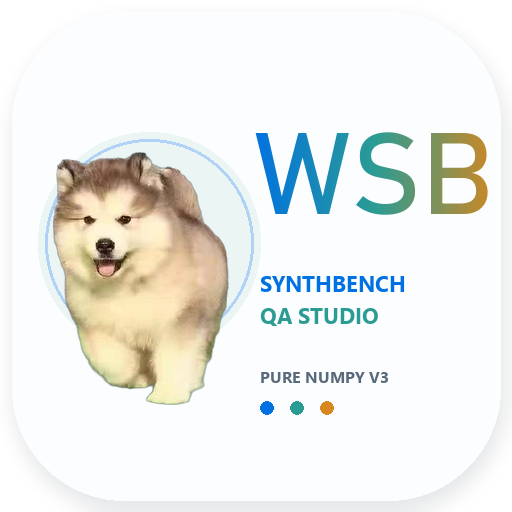
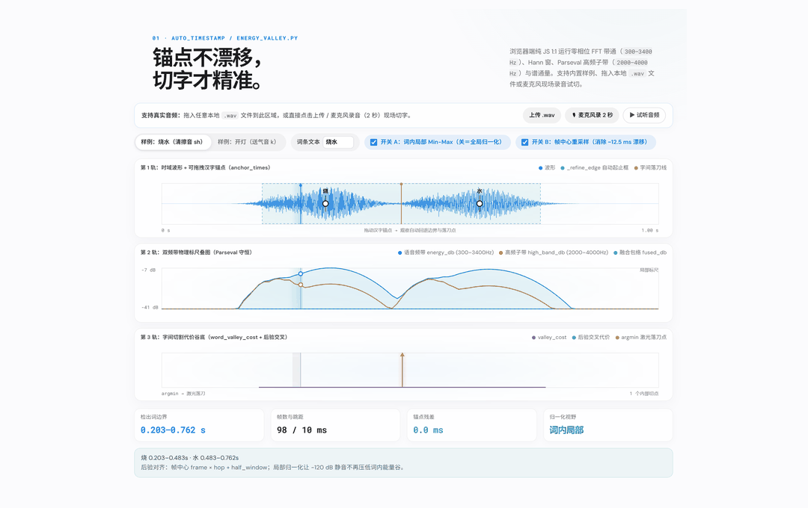
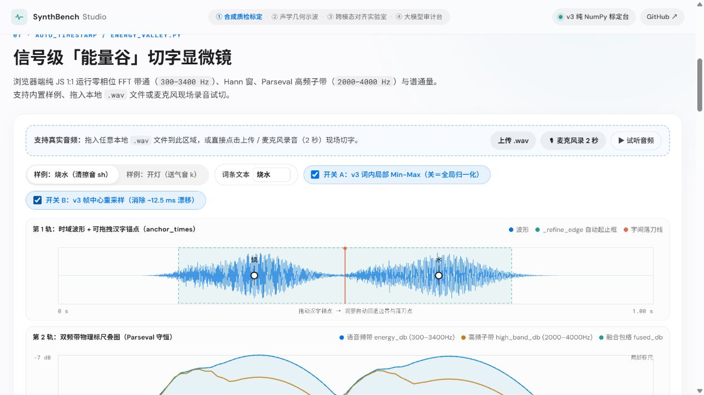
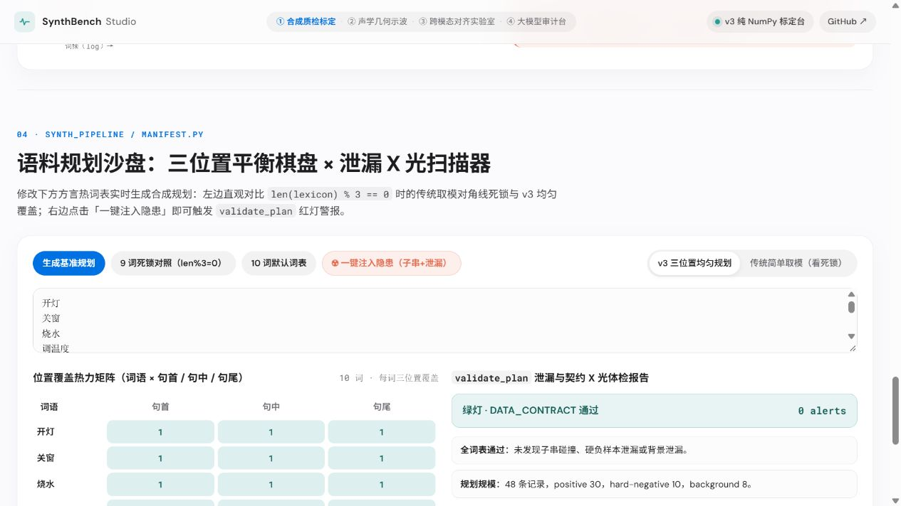
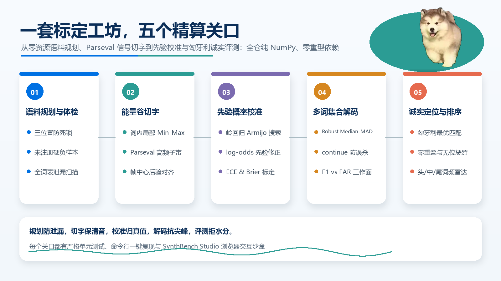

<p align="center">
  <a href="https://github.com/leeoisaboy/wu-speech-synthbench">
    
  </a>
</p>

<p align="center">
  <a href="README.en.md"></a>
  <a href="https://leeoisaboy.github.io/wu-speech-synthbench/"></a>
  
  
  
  
</p>

<h1 align="center">Wu-Speech-SynthBench</h1>

<p align="center"><strong>把零资源方言合成语料的规划、切字、校准与评测拆成可以逐项检查的白盒流程。</strong></p>



## 正在运行的界面

<p align="center">
  <a href="https://leeoisaboy.github.io/wu-speech-synthbench/">
    
  </a>
</p>

<p align="center"><strong><a href="https://leeoisaboy.github.io/wu-speech-synthbench/">进入在线 SynthBench Studio</a></strong></p>

这段动图截自真实运行的静态页面。页面不需要后端，也不会上传音频。拖入本地 WAV 或使用麦克风录音后，音频只在浏览器内存中解码。四个模块分别对应仓库里的自动切字、集合解码、概率校准、多区间定位和语料规划逻辑。

| 模块 | 页面里能看到什么 | 对应实现 |
| --- | --- | --- |
| 01 能量谷切字 | 波形锚点、双频带能量、谱通量代价谷、后验交叉和自动落刀线 | `auto_timestamp/energy_valley.py` |
| 02 集合解码与校准 | Robust Median-MAD、Z-score、`continue` 救援、可靠性曲线和工作面 | `set_prediction/multi_kw_decoder.py`、`score_vector_baseline.py` |
| 03 评测测谎仪 | 多区间匈牙利匹配、IoU 惩罚、诚实指标与词频偏置散点图 | `eval_metrics/localisation.py`、`ranking.py` |
| 04 语料规划沙盘 | 句首、句中、句尾覆盖热力图，子串冲突和负样本泄漏体检 | `synth_pipeline/manifest.py` |

<details>
<summary>展开四个模块的页面截图</summary>
<p align="center">
  
  
  
  
</p>
</details>

## 为什么做这个项目

低资源方言语音经常缺少成规模的录音、时间戳和负样本。团队通常先合成一批语料，再用自动切字生成监督区间，接着训练或调用集合解码器，最后用定位、召回和误报指标判断系统是否可用。每一步都能独立工作，但前一步的小偏差会在后一步被放大。

静音会把词内能量谷压平。高频清擦音可能在普通语音频带里已经掉进谷底。类别不平衡会让后验概率系统性偏高。多区间评测如果忽略零重叠同词，分数会明显虚高。硬负样本一旦混入已注册词，指标又会被污染。这个仓库把这些失败模式做成可复算的代码和可直接操作的页面。

核心包只依赖 NumPy。Studio 复用同一份导出数据，在浏览器内重算交互状态。页面用于解释方法和检查失败模式，正式实验结论以 Python 测试、CLI 输出和导出包为准。

## 项目追问什么

1. 词内局部归一化能否避免句首句尾的数字静音稀释真实切字谷。
2. Parseval 守恒的高频子带能量能否保住清擦音和送气音的边界。
3. 帧中心重采样能否消除半窗造成的系统时间漂移。
4. 集合解码器怎样在异常尖峰和概率排序分歧下保住真目标。
5. 先验修正能否把类别加权后的虚高后验拉回真实概率。
6. 多区间定位怎样同时惩罚脱靶同词和不可定位误报。
7. 三位置规划和全词表泄漏审计能否在生成语料前拦住数据契约问题。

## 五个关键工程修复

### 1. 词内局部 Min-Max

`segment_word` 只在 `[left : right + 1]` 的词内活动区间归一化能量与谱通量。句首和句尾的 `-120 dB` 数字静音不再参与词内缩放，字间能量谷不会被整句动态范围压成近乎平坦的直线。

### 2. Parseval 守恒的高频子带

`acoustic_features` 用一侧实 FFT 的 Parseval 权重计算 `2000–4000 Hz` 子带能量。窄带清擦音和送气音与时域 `energy_db` 使用同一物理 dB 标尺。`fused_db = max(energy_db, high_band_db - 6)` 保留普通频带已经衰减的辅音证据。

### 3. 帧中心后验对齐

外部后验概率按 `frame * hop + half_window` 重采样到声学帧中心。25 ms 分析窗对应 12.5 ms 半窗，旧实现忽略这个偏移时，后验交叉点会与真实声学边界错位。

### 4. 校准与先验修正

`LogisticCalibrator` 在 `class_weight="balanced"` 且开启 `correct_prior` 时执行精确的对数几率修正：

```text
logit(p_cal) = logit(p_bal) - ln(w1 / w0)
```

`decode_set` 在概率排序循环里使用 `continue` 跳过不满足 z-space margin 的候选，避免一个排序分歧项提前终止循环并误杀后面的真目标。

### 5. 诚实的多区间评测

`evaluate_multi_span_localisation` 对同词零重叠区间保留 `IoU = 0.0`，把 `no-position` 预测计入端到端 precision 分母，并按同词组执行最大权二分匹配。`sentence_recall_complete` 只统计正样本，负样本不再白送完整召回分。

## 实验证据

以下数字来自仓库内的确定性合成夹具和导出的 Studio 数据。它们用于验证接口、数值契约和失败模式，不代表真实吴语或普通话语料上的产品准确率。

| 探针 | 结果 | 说明 |
| --- | --- | --- |
| 烧水样例词内切分 | `0.2025–0.4725 s` 与 `0.4725–0.7625 s` | 98 个声学帧；Studio 与 Python 参考边界一致 |
| 未修正可靠性 | ECE `0.1878`，Brier `0.1286` | 类别加权后后验概率明显虚高 |
| 先验修正可靠性 | ECE `0.0282`，Brier `0.0805` | 可靠性曲线回到对角线附近 |
| 负样本地板分 | 天真口径 `0.68`，v3 口径 `0.36` | v3 只用正样本计算完整召回 |
| 多区间定位 | known-word IoU `0.7818`，precision `0.80`，recall `1.00` | 5 条预测中有 1 条 `no-position`，仍进入端到端 precision 分母 |
| 高频偏置模型 | Micro `84.66%`，Macro `62.30%`，Tail `31.50%` | 微平均接近均衡模型，长尾词已经明显崩盘 |
| 均衡模型 | Micro `85.74%`，Macro `83.40%`，Tail `80.50%` | 长尾召回恢复到与总体相近的水平 |
| 默认规划体检 | 27 条记录，0 条子串冲突、硬负泄漏和背景泄漏 | `demo_plan` 与 `validate_plan` 的公开合成夹具 |



## 方法

### 自动切字

声学特征包含 10 ms 跳距、25 ms Hann 窗、`300–3400 Hz` 零相位语音带通、时域窗口 RMS、高频子带能量和半波整流谱通量。`_refine_edge` 从粗锚点向两侧查找持续活跃区域，遇到连续静音后停止。字内切点只在相邻锚点之间的词内代价谷里取 `argmin`。

### 集合解码

单句候选先做池内标准化。Robust Median-MAD 用 `1.4826 * MAD` 估计尺度，在异常尖峰存在时保持基线稳定。校准器把 `[raw, norm, gap_to_top, rank_ratio]` 映射到概率，再用 `cap`、`margin`、`minimum_z` 和 `min_probability` 约束最终集合。

### 多区间定位

端到端匹配不关心词名，只衡量每个期望区间与任一预测区间的最大重叠。同词匹配按词分组执行，保留零重叠配对。最终同时报告 `precision_at_iou`、`positionable_precision_at_iou`、`recall_at_iou` 和 `f1_at_iou`。

### 规划与泄漏审计

规划器把目标词放到句首、句中、句尾和多目标长句。`validate_plan` 检查载体区间、子集隔离、硬负样本泄漏、背景泄漏和子串碰撞。默认混淆词从未注册池生成，避免硬负样本文本同时包含已注册目标。

## 快速开始

```bash
git clone https://github.com/leeoisaboy/wu-speech-synthbench.git
cd wu-speech-synthbench
python -m venv .venv
```

Windows PowerShell：

```powershell
.venv\Scripts\Activate.ps1
python -m pip install -e . pytest
```

Linux 或 macOS：

```bash
source .venv/bin/activate
python -m pip install -e . pytest
```

运行完整测试：

```bash
python -m pytest -q
```

当前测试结果为 `17 passed`。

生成一份确定性演示报告：

```bash
wu-speech-synthbench demo --multi-phrase-ratio 0.3 --output report.json
```

对已有集合样本执行校准拒识扫描：

```bash
wu-speech-synthbench evaluate \
  --sets eval_sets.jsonl \
  --calibrator-train cal_sets.jsonl \
  --caps 1,2,3 \
  --margins 0.5,1.5 \
  --min-probabilities none,0.3,0.5,0.7 \
  --normalization robust
```

## 使用 Studio

在线版本直接打开 GitHub Pages：

<https://leeoisaboy.github.io/wu-speech-synthbench/>

本地静态运行不需要后端：

```bash
python scripts/export_synthbench_bundle.py
python -m http.server 8765 --directory studio
```

浏览器打开 `http://127.0.0.1:8765`。

Studio 支持以下交互：

- 拖拽 WAV 或录制 2 秒麦克风音频，实时检查切字边界。
- 切换全局归一化与 v3 词内局部归一化。
- 切换未对齐后验与帧中心重采样。
- 调整候选尖峰、`cap`、`margin` 和 `min_probability`。
- 关闭或开启先验修正，观察 ECE、Brier 与可靠性曲线变化。
- 拖走预测区间或切换 `no-position`，比较天真指标与 v3 诚实指标。
- 修改词表，观察三位置覆盖和泄漏扫描结果。

## 仓库结构

```text
wu_speech_synthbench/
  auto_timestamp/
    energy_valley.py       零相位带通、Parseval 高频能量、词内归一化与切字
  set_prediction/
    multi_kw_decoder.py    池内标准化、集合解码、校准器拟合与工作面扫描
    score_vector_baseline.py
                           逻辑回归校准、ECE 与 Brier
  eval_metrics/
    localisation.py        单区间与多区间匈牙利定位评测
    ranking.py             排序指标、完整召回与词频偏置
  synth_pipeline/
    manifest.py            三位置规划、硬负样本、背景样本与泄漏审计
    demo.py                公开合成词表与演示规划
studio/
  index.html               无后端四模块交互页面
  static/studio.css        浅色长卷轴界面
  static/studio.js         浏览器端 FFT、解码、校准、匹配与扫描
  data/                    导出后的纯静态 JSON 包
docs/
  DATA_CONTRACT.md         数据字段与样本约束
  MODULE_MAP.md            模块职责与调用关系
  assets/                  小狗 Logo、双语横幅、流程图和演示动图
scripts/
  export_synthbench_bundle.py
                           调用真实 Python 模块导出 Studio 数据
  make_assets.py           生成 README 视觉资产
tests/
  17 项数值、音频、校准、匹配、规划与 Studio 契约测试
```

## 复现与测试

```bash
python -m compileall -q .
python -m pytest -q
node --check studio/static/studio.js
python scripts/export_synthbench_bundle.py
```

数据字段约束见 [docs/DATA_CONTRACT.md](docs/DATA_CONTRACT.md)，模块职责见 [docs/MODULE_MAP.md](docs/MODULE_MAP.md)。

## 低资源方言语音白盒研究四部曲

1. **Wu-Speech-SynthBench**：规划合成语料，执行信号切字、概率校准和诚实评测。
2. [Disentangle-Acoustic-Print](https://leeoisaboy.github.io/disentangle-acoustic-print/)：观察冻结声学轨迹的静态、运动、残差和速度视图。
3. [Dialect-CrossModal-Align](https://leeoisaboy.github.io/dialect-crossmodal-align/)：比较跨模态对齐、域正则和路由陷阱。
4. [AudioLLM-Latent-KWS](https://leeoisaboy.github.io/audiollm-latent-kws/)：审计冻结音频大模型的关键词检索、泄漏和阴性实验。

## 实验边界

- 仓库只提交代码、schema、确定性合成夹具和静态演示数据。
- 不包含真实音频、私有词表、说话人信息、模型权重或受限语料。
- Studio 中的内置样例用于解释算法，不代表真实语料上的识别率。
- 浏览器端 DSP 用于交互复现和教学，正式数值以 Python NumPy 实现为准。
- 规划生成器需要真实录音、转写和许可信息后才能用于正式评测。

## License

代码使用 MIT License。音频、模型、词表和派生特征保留各自原始许可。
